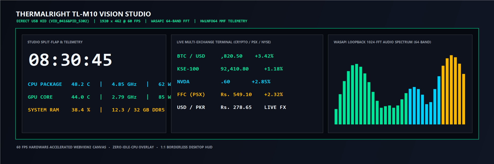
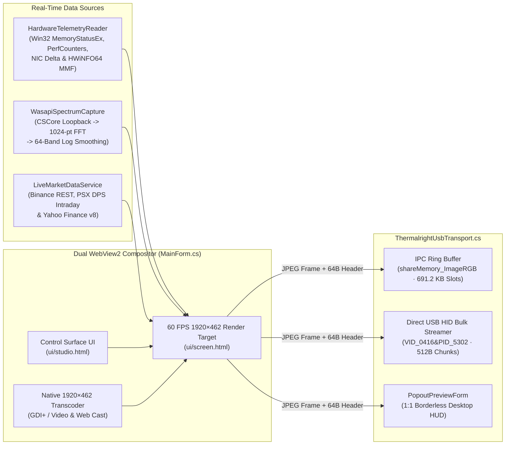

<div align="center">

# Thermalright TL-M10 Vision Studio

**High-Frequency `1920 × 462` Direct USB LCD Display Driver, WASAPI Audio Spectrum & Telemetry Engine**

[](https://github.com/harisherry/tl-m10-vision-studio/releases)
[](https://github.com/harisherry/tl-m10-vision-studio)
[-0078D6)](https://github.com/harisherry/tl-m10-vision-studio)
[](https://dotnet.microsoft.com/)
[](LICENSE)

[Architecture](#-system-architecture--usb-protocol) •
[Visual Engines & Themes](#-visual-engines--themes) •
[Quick Start](#-quick-start) •
[Building from Source](#-building-from-source)

</div>

---



**TL-M10 Vision Studio** is a low-latency, native 64-bit Windows display controller and real-time telemetry compositor engineered from the ground up to replace the stock `TRCC` utility for the **Thermalright TL-M10 Vision** (`1920 × 462` ultra-wide USB auxiliary display, `VID_0416&PID_5302` / `VID_87AD&PID_70DB`).

It combines a **C# (.NET 4.8) hardware & USB transport core**, a **dual Microsoft Edge WebView2 60 FPS hardware-accelerated render pipeline**, a **1024-bin WASAPI loopback FFT audio analyzer**, **HWiNFO64 shared-memory / Win32 telemetry**, and an **asynchronous multi-exchange financial ticker feed**.

---

## 🏗 System Architecture & USB Protocol



### USB Frame Packet Specification (`1920 × 462`)

Frames are encoded as baseline JPEG payloads prefixed with a 64-byte hardware command header and streamed either via the `shareMemory_ImageRGB` IPC ring buffer (`50 × 691,200` byte slots) or chunked into `512`-byte USB HID reports after the `0xDA 0xDB 0xDC 0xDD` device handshake:

| Byte Offset | Width | Value / Format | Description |
| :--- | :--- | :--- | :--- |
| `0x00..0x03` | 4 B | `12 34 56 78` | Magic frame sync signature |
| `0x04..0x07` | 4 B | `02 00 00 00` | Command opcode (`0x02` = JPEG frame write) |
| `0x08..0x0B` | 4 B | `80 07 00 00` | Little-endian horizontal resolution (`1920` px) |
| `0x0C..0x0F` | 4 B | `CE 01 00 00` | Little-endian vertical resolution (`462` px) |
| `0x38..0x3B` | 4 B | `02 00 00 00` | Sub-protocol transport flag |
| `0x3C..0x3F` | 4 B | `uint32 (LE)` | Encoded JPEG payload byte length ($N$) |
| `0x40..0x40+N` | $N$ B | `FF D8 ... FF D9` | Compressed `1920 × 462` frame payload |

---

## 🎨 Visual Engines & Themes

### 1. Precision Horology & Studio Clocks (`1920 × 462`)
- **Mooas Mechanical Split-Flap Desk Clock (`mooas-flip`)**: Ribbed matte-black split-flap drums, `AM`/`PM` indicator, central T-bridge pillar, rotary gear detail, dark walnut base, and 3D perspective card-drop animations.
- **3-Drum Studio Split-Flap (`flipclock`)**: Widescreen `HH : MM : SS` mechanical split-flap layout paired with live CPU, GPU, and RAM telemetry arcs.
- **Steampunk IN-18 Nixie Tube Clock (`nixieclock`)**: Six glowing orange vacuum cathode tubes with multi-layer anode mesh depth and brass housings.
- **Luxury Swiss Triple Chronograph (`swiss-chrono`)**: Center mechanical timepiece with a 60 Hz sweeping second hand flanked by CPU and GPU tachymeter subdials.
- **Cyber LED Dot-Matrix Master Clock (`led-matrix-clock`)**: Broadcast studio reference clock with a 60-LED seconds progress ring and calendar ribbon.
- **Illuminated Architectural Word Clock (`word-clock`)**: Typographic word matrix (`IT IS QUARTER PAST...`) paired with oversized architectural digits.

### 2. Live Multi-Market Financial Terminals
- **₿ Crypto & Bitcoin Live Terminal (`btc-terminal`)**: Real-time `BTC`, `ETH`, `SOL`, `BNB`, `XRP`, `DOGE`, and `ADA` orderbook tickers and 15m candlestick sparklines with multi-currency conversion (`USD`, `PKR`, `EUR`, `GBP`, `AED`, `SAR`, or dual `USD + PKR`).
- **🇵🇰 Pakistan Stock Exchange Terminal (`psx-stocks`)**: Direct intraday `KSE-100` index curve and blue-chip equities (`SYS`, `LUCK`, `OGDC`, `HUBC`, `MEBL`, `ENGRO`, `PPL`, `FFC`) streamed from `dps.psx.com.pk`.
- **🇺🇸 US Wall Street Equities (`us-stocks`)**: Intraday price action and sparkline boards for `NVDA`, `AAPL`, `TSLA`, `MSFT`, `AMZN`, `META`, `GOOGL`, and `AMD`.

### 3. Audio-Reactive & Telemetry Shaders
- **64-Band WASAPI Loopback Spectrum**: Real-time 1024-point FFT (`WasapiSpectrumCapture.cs`) driving Dual Analog Studio VU Meters, Synthwave Outrun, F1 Shift-Light Telemetry Strip, Matrix Digital Rain, Aurora Plasma Silk, Cyberpunk Reactors, Hyperspace Warp, Neural Constellation, Tokyo Midnight Rain, and Global Cyber Radar.
- **Built-In `1920 × 462` Media & Web Caster**:
  - Automatic aspect-ratio formatting for images (`PNG`, `JPG`, `WEBP`, `BMP`) and video/GIF streams (`MP4`, `WEBM`, `MOV`, `MKV`, `GIF`) across 4 framing modes: **Exact `1920×462` Fit**, **Smart Ambient Blur Wings**, **Triple 3× Panorama**, and **Widescreen Center Crop**.
  - Direct **YouTube & Web URL Casting** isolated from fullscreen game resolution changes.

---

## 🚀 Quick Start

### Option 1: Precompiled Release (Recommended)
1. Download **`TL-M10-Vision-Studio-v1.0.0-win-x64.zip`** from [**Releases**](https://github.com/harisherry/tl-m10-vision-studio/releases).
2. Extract and run **`Install-VisionStudio.bat`** (installs to `C:\TL-M10-Vision-Studio`, configures silent System Tray logon startup, and creates desktop shortcuts) or run **`Launch-VisionStudio.bat`** directly.

### Option 2: Build & Run from Source
```bat
git clone https://github.com/harisherry/tl-m10-vision-studio.git
cd tl-m10-vision-studio
Build-VisionStudio.bat
Launch-VisionStudio.bat
```

---

## 🛠 Building from Source

Compiles on Windows 10/11 using the built-in .NET Framework 4.8 / Visual Studio Roslyn `csc.exe` compiler with zero external SDK installation required:

```bat
Build-VisionStudio.bat
```

### Repository Structure

```text
tl-m10-vision-studio/
├── .github/workflows/
│   └── build.yml                    # Automated Windows x64 CI build verification
├── docs/
│   └── preview.png                  # Studio UI & 1920×462 viewport preview
├── lib/                             # Managed WebView2, CSCore WASAPI & USB HID assemblies
├── src/
│   ├── Program.cs                   # DPI-aware STAThread entry point & crash logger
│   ├── MainForm.cs                  # Dual WebView2 host, media transcoder & tray controller
│   ├── ThermalrightUsbTransport.cs  # MMF IPC & VID_0416&PID_5302 USB HID packet streamer
│   ├── HardwareTelemetryReader.cs   # Win32 MemoryStatusEx, NIC delta & HWiNFO MMF reader
│   ├── WasapiSpectrumCapture.cs     # CSCore WASAPI loopback 1024-FFT 64-band analyzer
│   ├── LiveMarketDataService.cs     # Async Binance, PSX DPS & Yahoo Finance REST engine
│   ├── PopoutPreviewForm.cs         # 1:1 1920×462 borderless desktop HUD overlay
│   └── TelemetryData.cs             # Sensor data contracts
├── ui/
│   ├── studio.html                  # Dark-mode studio control surface
│   ├── screen.html                  # 60 FPS 1920×462 HTML5 Canvas display engine
│   └── overlay.js                   # Client-side telemetry & spectrum bridge
├── Build-VisionStudio.bat           # Standalone x64 compiler script
├── Install-VisionStudio.bat         # One-click system installer & startup configurator
├── Launch-VisionStudio.bat          # Portable application launcher
├── VisionStudio.csproj              # SDK-style .NET 4.8 project file
└── LICENSE                          # MIT License
```

## 📄 License

Distributed under the **MIT License**. See [`LICENSE`](LICENSE) for details.
